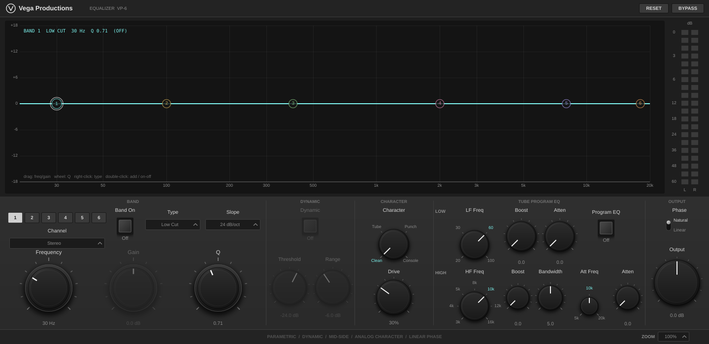

# Vega Productions — EQ (VP-6)



The core EQ of the Vega Productions suite. Windows VST3, plus macOS VST3 and AU.

## Features
| | |
|---|---|
| **6 parametric bands** | Bell, Low/High Shelf, Low/High Cut (12/24/48 dB/oct, resonant), Notch, Band Pass. Frequency 10 Hz–22 kHz, ±24 dB, Q 0.1–18. |
| **Interactive graph** | Drag a point to set frequency and gain, scroll to set Q, right-click to change type, channel, or dynamic mode, double-click to add a band or switch one on/off. Shows the pre-EQ (grey) and post-EQ (white) spectrum. |
| **Mid/Side per band** | Each band works on Stereo, Mid only, or Side only. The Mid and Side curves are drawn separately. |
| **Dynamic EQ** | Bells and shelves can become dynamic: set a Threshold and a Range (±24 dB). The band then cuts or boosts only when that frequency area gets loud, and the point moves live on the graph. |
| **Analog character** | **Clean** is transparent. **Tube** gives wide, smooth curves and 2nd-harmonic warmth. **Punch** uses proportional Q (narrower the harder you boost or cut) and a firm transformer edge. **Console** gives broad, musical bells and low-end transformer weight. Drive sets the amount, 2× oversampled. |
| **Tube Program EQ** | Passive, Pultec-style section: LF Boost and Atten at 20/30/60/100 Hz (use both for the classic "boost and cut" low end), HF Boost with Bandwidth at 3–16 kHz, HF Atten at 5/10/20 kHz. |
| **Linear phase** | Switch Phase to **Linear** for phase-accurate mix-bus and mastering work. This adds latency, which your DAW compensates automatically. Dynamic bands stay natural-phase. |
| **Workflow** | Output gain, LED meters, Reset, Bypass, 75–125 % zoom. |

## Install
**Windows (FL Studio):** in the **Actions** tab, open the latest run, download `VegaProductions-EQ-Windows-VST3`, unzip it, and copy `Vega Productions EQ.vst3` to `C:\Program Files\Common Files\VST3\`. Then run **Options → Manage plugins → Find more plugins** in FL Studio.

**Mac (Ableton Live):** download `VegaProductions-EQ-macOS-VST3-AU`, copy the `.vst3` to `~/Library/Audio/Plug-Ins/VST3/` and the `.component` to `~/Library/Audio/Plug-Ins/Components/`, then run once in Terminal:
```
xattr -cr ~/Library/Audio/Plug-Ins/VST3/"Vega Productions EQ.vst3" ~/Library/Audio/Plug-Ins/Components/"Vega Productions EQ.component"
```
